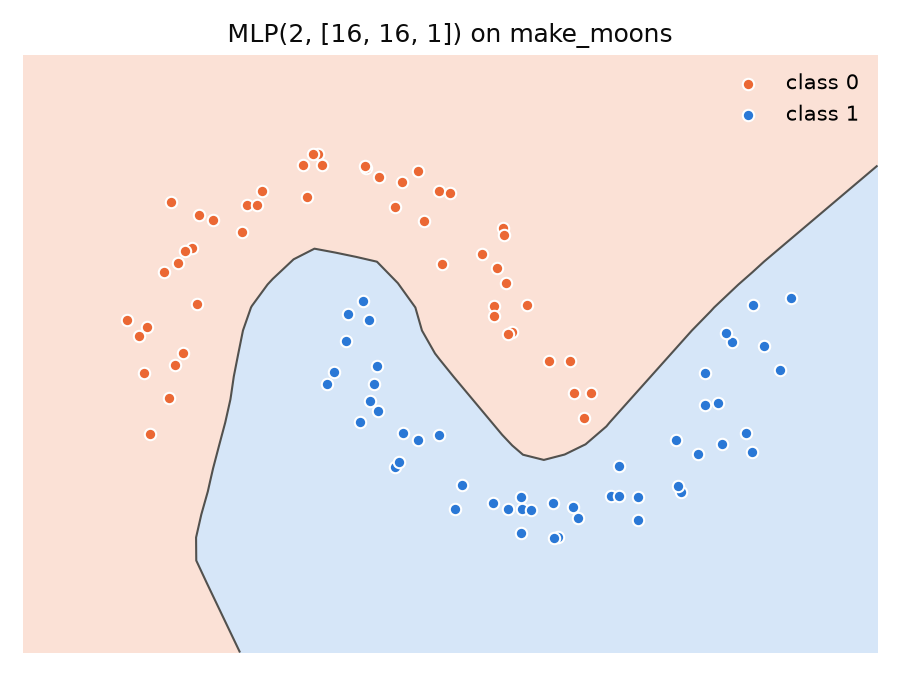
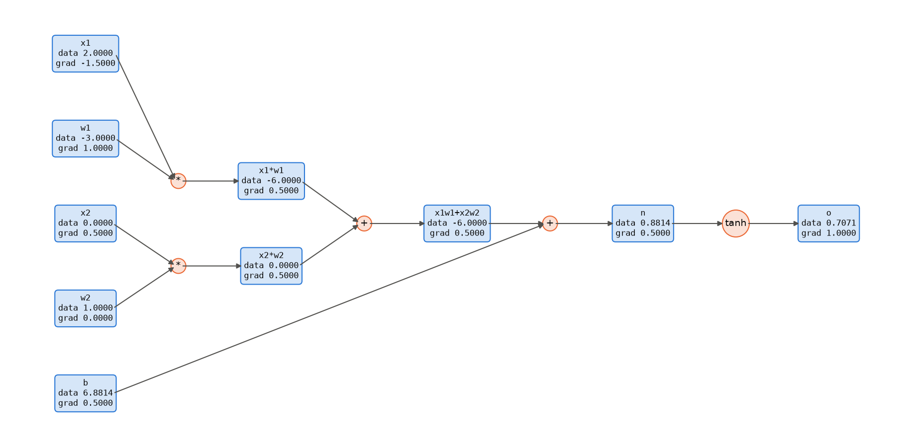

# Scalar autograd

A reverse-mode autodiff engine that works on single numbers, plus a small MLP built on top of it. The MLP learns to separate sklearn's two moons, and the engine can draw its own computation graph with matplotlib.

[Preview](#preview) · [Setup](#setup) · [Run](#run) · [Tests](#test)

## Preview



## Setup

```bash
pip install -r requirements.txt
```

## Run

```bash
python autograd.py           # 100 steps, about 3 minutes on a laptop CPU
python autograd.py --quick   # 20 steps
```

This writes `moons.png` (the decision boundary) and `graph.png`, which shows the graph of `tanh(x1*w1 + x2*w2 + b)` after backprop with each node's value and gradient:



## Test

```bash
python -m pytest -q
```

The tests build 30 random expressions and check every input gradient against central finite differences. They also compare a hand-written expression and a small MLP against torch autograd in float64.
